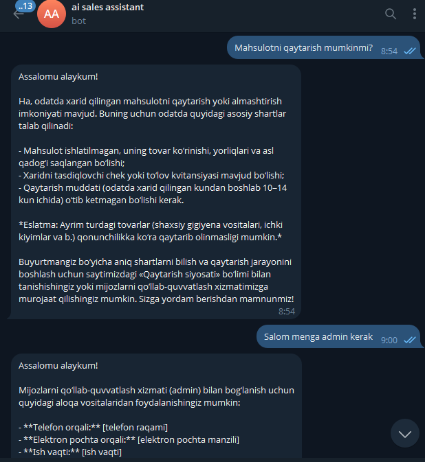

# 🤖 AI-based Customer Support & Sales Assistant System

[](https://www.python.org/)
[](https://fastapi.tiangolo.com/)
[](https://www.trychroma.com/)
[](https://ai.google.dev/)
[](https://docs.aiogram.dev/)

Elektron tijorat (E-Commerce) va onlayn savdo platformalari uchun mo'ljallangan zamonaviy, modulli va kengaytiriladigan (SaaS-ready) **Sun'iy Intellektga asoslangan Sotuvchi va Mijozlarni Qo'llab-quvvatlash Assistent Tizimi**.

Loyiha **RAG (Retrieval-Augmented Generation)** texnologiyasi asosida qurilgan bo'lib, do'konning FAQ va mahsulotlar ma'lumotlar bazasini **ChromaDB** vektor bazasida saqlaydi, **Google Gemini LLM** orqali tabiiy tilda savollarga aniq javob beradi hamda ko'p bosqichli suhbat xotirasiga (Memory) ega.

---

## 📱 Botning Amaliy Namoyishi (Demo)

Quyida tizimning Telegram kanali orqali mijozlar bilan o'zbek tilida tabiiy va tezkor muloqot qilishi ko'rsatilgan:

<p align="center">
  
</p>

> **Namoyishda:**
> 1. Mijoz mahsulotni qaytarish shartlari haqida so'raganda, bot do'konning ichki siyosatiga (FAQ datasetiga) tayangan holda batafsil va muloyim javob qaytaradi.
> 2. Mijoz administrator yoki operator bilan bog'lanmoqchi bo'lganida, tizim to'g'ri yo'naltiruvchi aloqa ma'lumotlarini taqdim etadi.

---

## 🏗️ Tizim Arxitekturasi

Loyiha ikkita mustaqil qismga (`ai-core` va `telegram-bot`) ajratilgan (Decoupled SaaS Architecture). Bu kelgusida bitta AI yadrosiga bir vaqtning o'zida bir nechta interfeyslarni (Telegram, Instagram, Web Widget) ulash imkonini beradi:

```text
[ Mijozlar: Telegram / Instagram / Web ]
                  │
                  ▼
      [ 1. Telegram Bot Klienti ] (`telegram-bot/`)
                  │ (HTTP POST /chat)
                  ▼
         [ 2. Asosiy AI Yadrosi & FastAPI ] (`ai-core/`)
                  ├──► [ Relatsion DB ] (Suhbat tarixi va sessiyalar: SQLite / PostgreSQL)
                  ├──► [ ChromaDB ] (Vektorli bilimlar bazasi / RAG)
                  └──► [ Google Gemini API ] (LLM generatsiyasi va Multi-Model Fallback)
```

---

## ✨ Asosiy Imkoniyatlar

- **Modulli SaaS Tuzilma:** Asosiy AI yadrosiga tegilmagan holda yangi mijozlar yoki qo'shimcha kanallarni (Instagram, WhatsApp, Web-sayt vidjeti) ulash imkoniyati.
- **Dinamik RAG Tizimi:** FAQ va katalog ma'lumotlarini semantik (ma'no bo'yicha) qidirish orqali mijoz savoliga eng to'g'ri javobni tanlaydi.
- **Avtomatik Qayta O'qitish (Auto-Reindexing):** `ai-core/data/` papkasiga yangi `.json` fayl tashlansa yoki mavjud fayl o'zgartirilsa, tizim MD5 xesh orqali buni avtomatik sezadi va vektor bazani qaytadan o'qitadi.
- **Ko'p Bosqichli Fallback (Multi-Model Resilience):** Agar asosiy AI modelida limit tugasa yoki vaqtinchalik uzilish bo'lsa, tizim to'xtab qolmay avtomatik navbatdagi modelga (`gemini-flash-latest`, `gemini-1.5-flash`, `gemini-pro`) o'tadi.
- **Suhbat Xotirasi (Conversation Memory):** Har bir foydalanuvchining (`user_id`) avvalgi xabarlarini eslab qoladi va muloqotni insondek davom ettiradi.
- **Universal JSON Formatlarni Qo'llab-quvvatlash:** Kaggle yoki boshqa manbalardan yuklangan har qanday shakldagi FAQ fayllarini taniy oladi.

---

## 📁 Loyiha Papka Tuzilishi

```text
AI-based-customer-support-system/
│
├── .env.example                       # Sozlamalar shabloni
├── .gitignore                         # Git uchun istisno fayli
├── README.md                          # Loyiha hujjatlari
│
├── image/                             # Loyiha suratlari
│   └── tg_bot_image.png               # Bot namoyishi skrinshoti
│
├── ai-core/                           # 🧠 Asosiy AI Backend (FastAPI)
│   ├── main.py                        # FastAPI server va routerlar
│   ├── rag_engine.py                  # ChromaDB va Gemini integratsiyasi (RAG)
│   ├── database.py                    # Ma'lumotlar bazasi va suhbat tarixi
│   ├── test_rag.py                    # Bosqichma-bosqich diagnostika skripti
│   ├── requirements.txt               # Backend uchun kutubxonalar
│   ├── data/                          # 📂 Ma'lumotlar bazasi (.json)
│   │   └── Ecommerce_FAQ_Chatbot_dataset.json
│   └── chroma_db/                     # Vektorli ma'lumotlar bazasi fayllari
│
└── telegram-bot/                      # 🤖 Telegram Bot Klienti
    ├── bot.py                         # aiogram 3.x bot kodi
    ├── config.py                      # Bot sozlamalari
    └── requirements.txt               # Bot uchun kutubxonalar
```

---

## 🛠️ Texnologiyalar Steki

- **Dasturlash tili:** Python 3.10+
- **Backend API:** FastAPI, Uvicorn
- **AI Model:** Google Gemini API (`gemini-flash-latest`, `gemini-1.5-flash`)
- **Vektorli Qidiruv (RAG):** ChromaDB
- **Relatsion Xotira:** SQLAlchemy (SQLite / PostgreSQL)
- **Kanal / Interfeys:** Telegram Bot (aiogram 3.x, aiohttp)

---

## 🚀 O'rnatish va Ishga Tushirish

### 1. Loyihani yuklab olish
```bash
git clone https://github.com/Yasmina1602/AI-based-customer-support-system.git
cd AI-based-customer-support-system
```

### 2. Virtual muhit yaratish va kutubxonalarni o'rnatish
```bash
# Virtual muhit ochish
python -m venv venv

# Faollashtirish (Windows):
.\venv\Scripts\activate
# (Linux/macOS):
source venv/bin/activate

# Kutubxonalarni o'rnatish:
pip install -r ai-core/requirements.txt
pip install -r telegram-bot/requirements.txt
```

### 3. `.env` faylini sozlash
Loyihaning asosiy papkasida `.env` faylini yarating (yoki `.env.example` dan nusxa oling):
```env
# Google AI Studio API kaliti (https://aistudio.google.com/app/apikey)
GEMINI_API_KEY=sizning_gemini_api_kalitingiz

# Telegram Bot Token (@BotFather dan olinadi)
BOT_TOKEN=sizning_telegram_bot_tokeningiz

# Ma'lumotlar bazasi (standart SQLite)
DATABASE_URL=sqlite:///./chat_history.db

AI_CORE_URL=http://127.0.0.1:8000
```

---

## 🏃 Tizimni Ishga Tushirish

Tizim ishlashi uchun **ikkita terminal** oynasi ochiladi:

### 1-Terminal: AI Core (FastAPI Backend)
```bash
cd ai-core
python main.py
```
> Server `http://127.0.0.1:8000` manzilida ishga tushadi. Birinchi marta ishga tushganda u `ai-core/data/` papkasidagi fayllarni o'qib, ChromaDB vektor xotirasini shakllantiradi.

### 2-Terminal: Telegram Bot
```bash
cd telegram-bot
python bot.py
```
> Bot Telegram tarmog'iga ulanadi va mijozlar yozgan xabarlarni AI Core ga uzatib javob qaytaradi.

---

## 📊 O'z Ma'lumotlaringizni (Dataset) Yuklash

O'zingizning do'koningiz ma'lumotlarini o'qitish juda oson:
1. Istalgan `.json` formatdagi FAQ faylingizni `ai-core/data/` papkasiga tashlang.
2. Format namunasi:
   ```json
   {
     "questions": [
       { "question": "Yetkazib berish qancha vaqt oladi?", "answer": "Toshkent bo'ylab 1 kunda yetkaziladi." }
     ]
   }
   ```
3. Fayl qo'shilishi yoki o'zgarishi bilan server avtomatik ravishda yangi ma'lumotlarni o'zlashtiradi (qayta indekslaydi).
4. Shuningdek, serverni to'xtatmasdan darhol yangilash uchun brauzerda:
   `POST http://127.0.0.1:8000/reload-data` so'rovini yuborish kifoya.

---

## 📡 API Endpointlar

AI Core ishlab turganda interaktiv Swagger hujjatlari `http://127.0.0.1:8000/docs` manzilida ochiq bo'ladi:

| Metod | Endpoint | Vazifasi |
|---|---|---|
| `POST` | `/chat` | Foydalanuvchi savolini qabul qilib, kontekstga asoslangan AI javobini qaytaradi |
| `POST` | `/reload-data` | `data/` papkasidagi fayllarni darhol qayta indekslash (re-index) |
| `GET` | `/docs` | Interaktiv Swagger API hujjatlari |

---

## 📄 Muallif va Litsenziya

Loyiha erkin foydalanish va rivojlantirish uchun [MIT License](LICENSE) asosida taqdim etiladi.
Murojaat va takliflar uchun GitHub issues orqali bog'lanishingiz mumkin.
